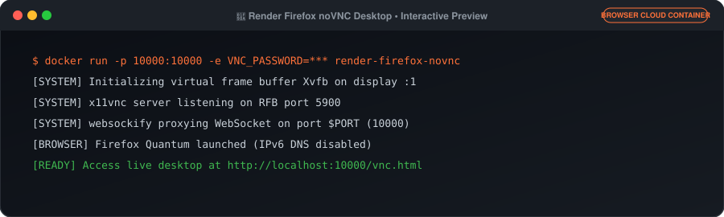
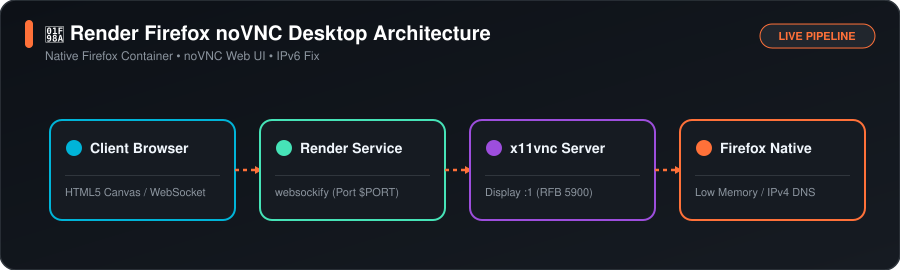

<h1 align="center">🦊 Render Firefox noVNC Desktop</h1>

<p align="center">
  <a href="https://github.com/itzxsahil">
    
  </a>
</p>

<p align="center">
     
</p>

---

## 📸 Project Preview

<p align="center">
  
</p>

---

# 🚀 Overview

Run a production-ready, secure instance of **Mozilla Firefox** directly in any web browser over **noVNC** and WebSockets, tailored for continuous cloud execution on **Render** and **Railway**.

---

# 🏗️ System Architecture & Data Flow

<p align="center">
  
</p>

<br>

The client web browser communicates over WebSockets with **websockify**, forwarding RFB graphical display protocols to **x11vnc** which renders native Mozilla Firefox inside an isolated Xvfb display buffer.

---

# ✨ Features

✅ **Zero IPv6 DNS Hangs**: Prefers IPv4 DNS by default to prevent connection dropouts in cloud containers.\n✅ **Resource Friendly**: Optimized Fluxbox + Xvfb display consuming minimal RAM.\n✅ **VNC Password Authentication**: Enforces secure access via `VNC_PASSWORD`.\n✅ **Dynamic Port Support**: Works automatically with Render's assigned `$PORT`.

---

# 📦 Installation & Quickstart

### Cloud Deployment (Render)\n[](https://render.com)\n\nSet environment variables in Render:\n- `VNC_PASSWORD`: Set your custom password.\n- `START_URL`: Default homepage (e.g. `https://www.google.com`).\n\n### Local Docker Run\n```bash\ndocker build -t render-firefox-novnc .\ndocker run -p 10000:10000 -e VNC_PASSWORD="yourpassword" render-firefox-novnc\n```\nVisit `http://localhost:10000/vnc.html` in your browser.

---

# 👤 Author & Support
- Built with ❤️ by [@itzxsahil](https://github.com/itzxsahil)
- Star ⭐ this repository if you find it helpful!
