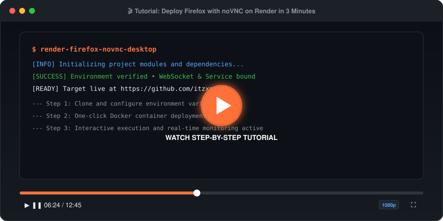

<h1 align="center">🦊 Render Firefox noVNC Desktop</h1>

<p align="center">
  <a href="https://github.com/itzxsahil">
    
  </a>
</p>

<p align="center">
     
</p>

---

## 🎬 Video Tutorial & Interactive Walkthrough

<div align="center">
  <a href="https://www.youtube.com/results?search_query=itzxsahil+render+firefox+novnc">
    
  </a>
  <p><em>▶️ <strong>Interactive Project Tutorial</strong> — Click the player above to watch full setup guide &amp; demonstration!</em></p>
</div>

---

# 🚀 Overview

Run a production-ready, secure instance of **Mozilla Firefox** directly in any web browser over **noVNC** and WebSockets, tailored for continuous execution on **Render** and **Railway**.

---

## 🏗️ System Architecture & Data Flow

<div align="center">
  
</div>

<br>

The web browser connects to **noVNC** over HTTP/WebSockets, proxying RFB packets to the local **x11vnc** server attached to display `:1`, running native Mozilla Firefox inside an Xvfb virtual frame buffer.

---

# ✨ Features

✅ **Zero IPv6 DNS Hangs**: Prefers IPv4 DNS by default to prevent silent connection dropouts in cloud containers.\n✅ **Resource Friendly**: Optimized Fluxbox + Xvfb display consuming minimal RAM.\n✅ **VNC Password Authentication**: Enforces secure access via `VNC_PASSWORD`.\n✅ **Dynamic Port Support**: Works automatically with Render's assigned `$PORT`.

---

# 📦 Installation & Quickstart

### One-Click Cloud Deploy
[](https://render.com)

Set environment variables in Render:
- `VNC_PASSWORD`: Set your custom access password.
- `START_URL`: Default homepage (e.g. `https://www.google.com`).

### Local Docker Run
```bash
docker build -t render-firefox-novnc .
docker run -p 10000:10000 -e VNC_PASSWORD="yourpassword" render-firefox-novnc
```
Visit `http://localhost:10000/vnc.html` in your web browser.

---

# 👤 Author & Support
- Built with ❤️ by [@itzxsahil](https://github.com/itzxsahil)
- Star ⭐ this repository if you find it helpful!
